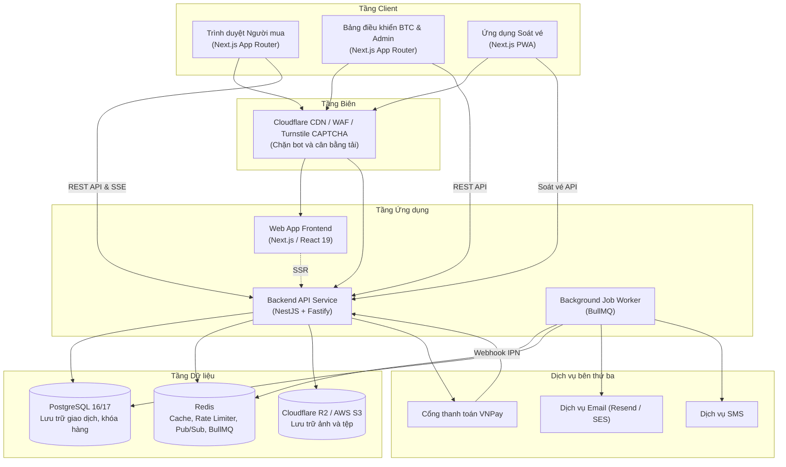
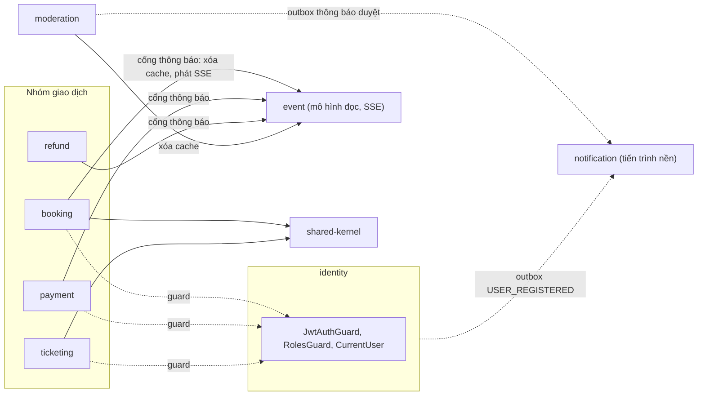
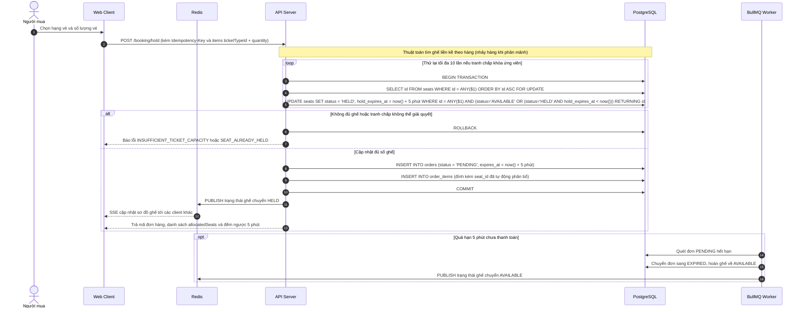
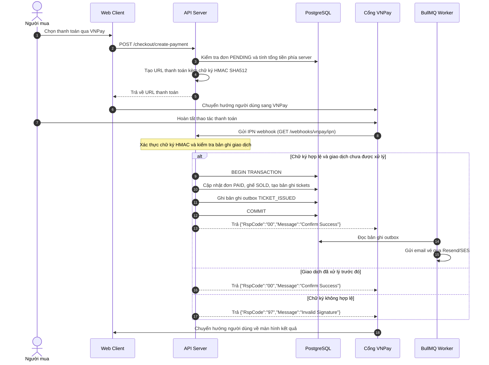
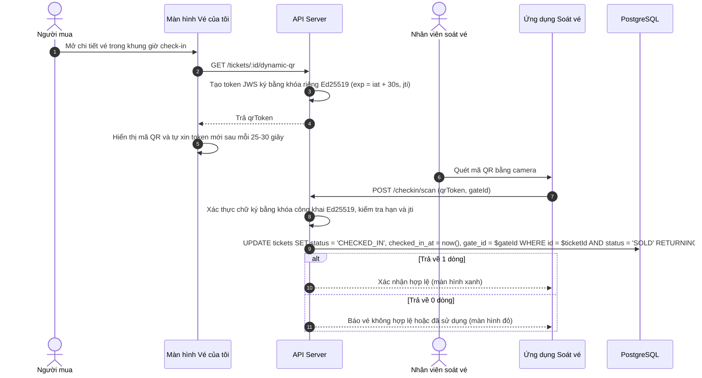
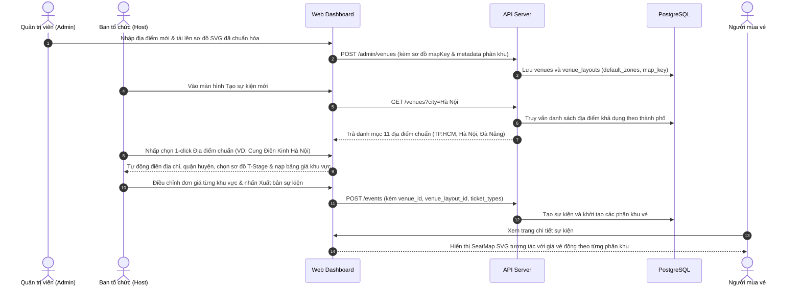

# Kiến trúc hệ thống

Tài liệu này mô tả kiến trúc tổng thể, mô hình phân chia module trong monorepo và các luồng xử lý đồng thời của hệ thống TicketHub.

## Kiến trúc tổng thể

Hệ thống được thiết kế theo mô hình monorepo, chia tách ứng dụng web và API backend, sử dụng PostgreSQL làm nơi lưu trữ trạng thái giao dịch và Redis làm lớp đệm trung gian.



## Cấu trúc thư mục

Kho mã nguồn sử dụng pnpm workspaces để quản lý các gói:

- `apps/web`: Ứng dụng giao diện xây dựng bằng Next.js App Router, tổ chức theo từng tính năng tương ứng với bounded context của backend tại `apps/web/src/features/` (xem mục "Kiến trúc frontend theo tính năng"). Gồm trang công khai, trang mua vé, cổng ban tổ chức và cổng quản trị.
- `apps/api`: Dịch vụ backend xây dựng bằng NestJS trên nền tảng Fastify, tổ chức theo Domain-Driven Design với 12 bounded context đặt tại `apps/api/src/contexts/` (xem mục "Kiến trúc Domain-Driven Design cho backend").
- `packages/shared`: Thư viện dùng chung chứa định nghĩa kiểu dữ liệu TypeScript, schema xác thực Zod và hằng số hệ thống.

## Kiến trúc Domain-Driven Design cho backend

Backend (`apps/api`) được tổ chức theo Domain-Driven Design chiến thuật. Mỗi bounded context sở hữu một vùng nghiệp vụ, gồm quy tắc nghiệp vụ thuần, các use case, adapter hạ tầng và lớp giao tiếp HTTP. Hành vi của các API không thay đổi so với trước khi tái cấu trúc: đường dẫn, phản hồi và mã lỗi giữ nguyên, nên [API_CONTRACT.md](API_CONTRACT.md) và [ERD.md](ERD.md) không đổi.

### Bản đồ bounded context

| Context        | Trách nhiệm nghiệp vụ                                                                                                                              | Nhóm API chính                                       |
| :------------- | :------------------------------------------------------------------------------------------------------------------------------------------------- | :--------------------------------------------------- |
| `identity`     | Đăng ký, xác thực email, đăng nhập, khóa tài khoản sau 5 lần sai, làm mới phiên; cung cấp guard JWT và RBAC cho các context khác                   | `/api/v1/auth/*`                                     |
| `event`        | Vòng đời sự kiện của Ban tổ chức (DRAFT, khóa lạc quan theo `version`), sinh sơ đồ ghế, mô hình đọc sơ đồ ghế và tồn kho, luồng SSE trạng thái ghế | `/api/v1/organizer/events`, `/api/v1/events`         |
| `venue`        | Danh mục địa điểm chuẩn và mẫu sơ đồ SVG                                                                                                           | `/api/v1/venues`, `/api/v1/admin/venues`             |
| `search`       | Tìm kiếm sự kiện đã công bố (full-text không dấu, lọc, phân trang cursor)                                                                          | `/api/v1/search/events`                              |
| `upload`       | Cấp URL tải ảnh sự kiện lên S3 và xác nhận ảnh (kích thước, quyền sở hữu khóa, chữ ký tệp)                                                         | `/api/v1/uploads/*`                                  |
| `booking`      | Giữ chỗ trực tiếp, tự động phân bổ ghế liền kề, khu đứng theo bộ đếm, hủy giữ chỗ, thu hồi đơn hết hạn, đơn hàng của người mua                     | `/api/v1/booking/*`, `/api/v1/buyer/orders`          |
| `payment`      | Tạo URL thanh toán VNPay, xử lý webhook IPN, cấp vé sau khi thanh toán                                                                             | `/api/v1/payments/*`                                 |
| `refund`       | Chính sách hoàn tiền, xem trước và thực thi hoàn tiền theo từng vé, phân bổ voucher theo tỷ lệ                                                     | `/api/v1/refund/*`                                   |
| `ticketing`    | Vé của tôi, mã QR động Ed25519, soát vé bằng QR, tra cứu thủ công dự phòng                                                                         | `/api/v1/tickets/*`, `/api/v1/gate/*`                |
| `moderation`   | Kiểm duyệt 2 lớp (KYC Ban tổ chức, phê duyệt sự kiện), Kill Switch, khôi phục sự kiện, truy vấn nhật ký kiểm toán                                  | `/api/v1/admin/organizers`, `/api/v1/admin/events`   |
| `payout`       | Quyết toán cho Ban tổ chức, phê duyệt và tạm giữ lệnh chi trả, đối soát giao dịch VNPay                                                            | `/api/v1/admin/payouts`, `/api/v1/organizer/payouts` |
| `notification` | Tiến trình nền: chuyển outbox sang hàng đợi email, worker gửi email, phục hồi outbox bị kẹt                                                        | Không có HTTP; chạy bằng các script `start:*`        |

Mã dùng chung giữa các context đặt tại `apps/api/src/shared-kernel/` và chỉ chứa hàm thuần không phụ thuộc framework (hiện là cách tính giá thực trả sau voucher và nhãn vị trí ghế của vé). Schema Drizzle nằm ở `apps/api/src/database/schema/` và được dùng chung (xem mục "Cơ sở dữ liệu dùng chung").



### Cấu trúc 4 tầng trong mỗi context

```
apps/api/src/contexts/<context>/
├── domain/           # Mô hình, lỗi nghiệp vụ, quy tắc thuần, cổng (port)
├── application/      # Use case / dịch vụ ứng dụng, điều phối qua các cổng
├── infrastructure/   # Adapter: Drizzle, Redis, BullMQ, S3, VNPay, Resend, JWT
├── interface/        # Controller NestJS, guard, bộ ánh xạ lỗi sang HTTP, entrypoint tiến trình
├── <context>.composition.ts   # Lắp ráp use case với adapter thật (composition root)
└── <context>.module.ts        # Khai báo NestJS Module và provider
```

Quy tắc phụ thuộc (một chiều, được kiểm tra tự động bởi `apps/api/test/architecture.test.ts`):

| Tầng             | Được phụ thuộc                                                               | Không được phụ thuộc                                                          |
| :--------------- | :--------------------------------------------------------------------------- | :---------------------------------------------------------------------------- |
| `domain`         | `@tickethub/shared`, `zod`, thư viện chuẩn `node:*`, chính tầng `domain`     | NestJS, Drizzle, Redis, BullMQ, cơ sở dữ liệu, cấu hình, context khác         |
| `application`    | `domain` cùng context, `shared-kernel`, `@tickethub/shared`, `zod`, `node:*` | Framework, hạ tầng, `interface`, context khác                                 |
| `infrastructure` | `domain` cùng context, `database/`, `config/`                                | `application`, `interface`, context khác                                      |
| `interface`      | `application` và `domain` cùng context, guard và decorator của `identity`    | `infrastructure` và `database/` (trừ các ngoại lệ ghi bên dưới), context khác |

Các tệp `*.module.ts` và `*.composition.ts` ở gốc context là nơi duy nhất được nối các tầng và các context với nhau.

### Giao tiếp giữa các context

- Các context không gọi trực tiếp use case hay repository của nhau. Khi cần tác động sang context khác, context gọi định nghĩa một cổng trong `domain` của chính nó (ví dụ `InventoryNotifier` của `booking`, `SettlementNotifier` của `payment`, `RefundNotifier` của `refund`). Adapter của cổng đó nằm ở `infrastructure` và nhận phụ thuộc bên ngoài bằng kiểu cấu trúc (structural type), nên không import mã của context kia.
- Context `event` công bố hai khả năng cho các context khác: xóa cache đọc (`EventReadModel.invalidate`) và phát trạng thái ghế qua SSE (`SeatStreamService.publishSeatStatusChanged`). `booking`, `payment`, `refund` và `moderation` chỉ gọi hai khả năng này sau khi giao dịch cơ sở dữ liệu đã commit.
- Mọi context có API HTTP dùng guard và decorator của `identity` (`JwtAuthGuard`, `RolesGuard`, `@Roles`, `@CurrentUser`). Đây là ngoại lệ duy nhất cho phép tầng `interface` import trực tiếp context khác.
- Các sự kiện bất đồng bộ đi qua bảng `outbox` (Transactional Outbox), không qua lời gọi hàm.

### Lắp ráp phụ thuộc

Use case là lớp TypeScript thuần nhận các cổng qua constructor, không dùng decorator NestJS. Hàm `create<Context>...()` trong `<context>.composition.ts` dựng use case với adapter Drizzle, Redis hoặc dịch vụ ngoài thật, và nhiều hàm nhận tham số `overrides` để thay bằng cổng giả khi viết test. `<context>.module.ts` chỉ đăng ký kết quả của hàm lắp ráp thành provider.

### Xử lý lỗi

Tầng `domain` ném lỗi nghiệp vụ riêng của context (ví dụ `RefundDomainError`, `BookingDomainError`) mang theo `kind` (`NOT_FOUND`, `FORBIDDEN`, `CONFLICT`, `BAD_REQUEST`, `UNAUTHORIZED`) và mã lỗi ổn định. Chỉ tầng `interface` biết HTTP: mỗi context có một bộ ánh xạ (`*-http.ts` hoặc hàm trong controller) đổi lỗi nghiệp vụ thành ngoại lệ NestJS tương ứng và giữ nguyên hình dạng phản hồi cũ. Hình dạng này khác nhau giữa các context vì phải giữ tương thích: một số trả `{ success: false, error: { code, message, timestamp } }`, một số trả chuỗi `CODE: mô tả`.

### Giao dịch và khóa dòng

Các luồng ghi nhiều bước (giữ chỗ, hoàn tiền, xử lý IPN, kiểm duyệt, phê duyệt quyết toán) chạy qua một cổng đơn vị công việc (`...UnitOfWork`). Adapter Drizzle mở một Database Transaction và trao cho use case một đối tượng giao dịch với các thao tác có tên theo nghiệp vụ. Use case quyết định thứ tự thao tác, adapter thực hiện câu lệnh SQL. Các câu lệnh khóa (`SELECT ... FOR UPDATE`, `FOR UPDATE SKIP LOCKED`, cập nhật có điều kiện `WHERE status = ...`) được giữ nguyên trong adapter. Không gọi API bên thứ ba bên trong giao dịch.

### Cơ sở dữ liệu dùng chung

Toàn bộ context dùng chung một PostgreSQL và một bộ schema Drizzle tại `apps/api/src/database/schema/`. Điều này là quyết định có chủ đích: tồn kho, đơn hàng và vé cần tính nhất quán giao dịch mạnh, và workflow kiểm tra đồng bộ tài liệu đọc schema ở đường dẫn cố định. Hệ quả cần lưu ý: một số adapter đọc bảng thuộc context khác (ví dụ `payout` đọc `orders`, `refunds`, `transactions`; `ticketing` nối `orders`, `events`). Việc đọc này chỉ nằm ở tầng `infrastructure`; quy tắc nghiệp vụ không phụ thuộc cấu trúc bảng của context khác.

### Sự kiện outbox và tiến trình nền

Context `notification` chạy ba tiến trình độc lập (`pnpm --filter @tickethub/api start:outbox-dispatcher`, `start:email-worker`, `start:outbox-recovery`). Tình trạng tiêu thụ các sự kiện outbox hiện tại:

| Sự kiện outbox                                                                 | Bên ghi             | Bên tiêu thụ                                    |
| :----------------------------------------------------------------------------- | :------------------ | :---------------------------------------------- |
| `USER_REGISTERED`                                                              | `identity`          | Email worker (email xác thực)                   |
| `ORGANIZER_APPROVED`, `ORGANIZER_REJECTED`, `EVENT_APPROVED`, `EVENT_REJECTED` | `moderation`        | Email worker (email thông báo)                  |
| `EVENT_CREATED`, `EVENT_SUBMITTED_FOR_APPROVAL`                                | `event`             | Chưa có tiến trình tiêu thụ                     |
| `ORDER_HOLD_CREATED`, `ORDER_HOLD_RELEASED`                                    | `booking`           | Chưa có tiến trình tiêu thụ                     |
| `ORDER_PAID`                                                                   | `payment`           | Chưa có tiến trình tiêu thụ                     |
| `REFUND_REQUESTED`                                                             | `refund`, `payment` | Tiến trình hoàn tiền (`start:refund-processor`) |
| `PAYMENT_EXPIRED_REFUND_NOTICE`                                                | `payment`           | Email worker (email giải thích hoàn tiền)       |
| `EVENT_SUSPENDED`, `EVENT_RESUMED`                                             | `moderation`        | Chưa có tiến trình tiêu thụ                     |

#### Tiến trình hoàn tiền VNPay

Context `payment` có thêm tiến trình `pnpm --filter @tickethub/api start:refund-processor` (`payment/interface/refund-processor.ts`). Tiến trình chỉ chạy khi `ENABLE_VNPAY_REFUND_PROCESSING=true` và cấu hình thông tin đăng nhập VNPay thật (từ chối giá trị mẫu `TEST_TMN_CODE`, `TEST_HASH_SECRET`). Quy trình xử lý mỗi sự kiện `REFUND_REQUESTED`:

1. Nhận sự kiện bằng cập nhật có điều kiện `PENDING` sang `PROCESSING`, đồng thời chuyển các bản ghi `refunds` sang `PROCESSING` trước khi gọi VNPay, nên tiến trình chết giữa chừng không dẫn tới gửi lặp.
2. Gọi API hoàn tiền của VNPay (`vnp_Command=refund`, `vnp_TransactionType` là `02` khi hoàn toàn phần, `03` khi hoàn một phần) bên ngoài mọi Database Transaction. Mã `vnp_RequestId` suy ra ổn định từ định danh sự kiện outbox.
3. Hoàn tất trong một transaction: `refunds` thành `COMPLETED`, outbox thành `COMPLETED`, và đơn `PAYMENT_EXPIRED_REFUND_PENDING` thành `REFUNDED`.

Kết quả gọi được phân loại như sau:

| Kết quả                                                     | Xử lý                                                                                    |
| :---------------------------------------------------------- | :--------------------------------------------------------------------------------------- |
| Mã `00` và chữ ký phản hồi hợp lệ                           | Hoàn tất như trên                                                                        |
| Mã từ chối rõ ràng (`02`, `03`, `91`, `93`, `95`, `97`)     | `refunds` và outbox thành `FAILED`, cần xử lý thủ công                                   |
| Lỗi kết nối trước khi yêu cầu tới VNPay                     | Trả về `PENDING`, thử lại với khoảng lùi tăng dần, tối đa 5 lần rồi `FAILED`             |
| Mã `94`, `99`, timeout, sai chữ ký, phản hồi không đọc được | Giữ `PROCESSING`, ghi chú lỗi, không bao giờ tự gửi lại; cần đối soát thủ công với VNPay |

Thời điểm giao dịch gốc (`vnp_TransactionDate`) lấy từ `vnp_CreateDate` lưu trong `transactions.raw_callback` khi tạo URL thanh toán; thiếu thì dùng `created_at` của giao dịch. Cách xử lý này chưa được kiểm chứng với môi trường sandbox thật của VNPay, chỉ được kiểm thử với máy chủ HTTP giả cục bộ.

#### IPN thành công đến muộn

Khi IPN thành công (`vnp_ResponseCode == '00'`) đến sau khi đơn đã `EXPIRED` hoặc `CANCELLED` (hoặc `PENDING` quá hạn), `ProcessVnpayIpnUseCase` xử lý trong một transaction: nếu sự kiện còn `PUBLISHED` và ghế hoặc tồn kho vé đứng còn dùng được thì khôi phục và cấp vé; ngược lại đơn chuyển sang `PAYMENT_EXPIRED_REFUND_PENDING`, tạo bản ghi hoàn tiền 100% và ghi các sự kiện outbox `REFUND_REQUESTED` và `PAYMENT_EXPIRED_REFUND_NOTICE`. IPN thất bại đến muộn vẫn ghi nhận để đối soát thủ công (`MANUAL_REVIEW`).

### Kiểm thử theo tầng

| Loại kiểm thử                       | Mục tiêu                                                                 | Cách chạy                                                            |
| :---------------------------------- | :----------------------------------------------------------------------- | :------------------------------------------------------------------- |
| Quy tắc `domain` (đơn vị)           | Hàm thuần: tính tiền hoàn, chọn ghế liền kề, quy tắc đăng nhập, đối soát | Không cần cơ sở dữ liệu                                              |
| Use case với cổng giả               | Luồng điều phối và nhánh lỗi của `application`                           | Dùng `overrides` của hàm lắp ráp hoặc kho trong bộ nhớ               |
| Adapter và luồng cốt lõi (tích hợp) | Giữ chỗ, thanh toán IPN, hoàn tiền, soát vé, kill switch, outbox         | PostgreSQL và Redis thật, không mock (theo quy chuẩn kiểm thử dự án) |
| Kiến trúc                           | Quy tắc phụ thuộc giữa các tầng và context                               | `apps/api/test/architecture.test.ts`                                 |

Bộ test tích hợp IPN của VNPay chỉ chạy khi `DATABASE_URL` trỏ tới cơ sở dữ liệu có tên khớp biến `IPN_TEST_DB_NAME` (mặc định `tickethub_ipn_test`); nếu không, bộ này tự bỏ qua.

### Ngoại lệ có chủ đích với quy tắc phụ thuộc

Các ngoại lệ sau được liệt kê trong `architecture.test.ts` và cần lý do khi thêm mới:

- `event/interface/events.controller.ts` dùng trực tiếp `SeatStreamService` vì luồng SSE trả về `Observable` từ adapter Redis Pub/Sub.
- Các entrypoint tiến trình nền của `notification` (`outbox.dispatcher.ts`, `outbox-recovery.ts`, `email.worker.ts`) lắp ráp adapter và đóng kết nối, nên được dùng `infrastructure`, `database/` và `config/`.
- `identity/interface/guards/jwt-auth.guard.ts` đọc bí mật JWT từ `config/`, và `search/interface/search-rate-limit.guard.ts` lấy client Redis qua token DI để giới hạn tần suất.

### Thêm một chức năng mới

1. Xác định bounded context sở hữu chức năng. Nếu chưa có context phù hợp, tạo thư mục mới với đủ bốn tầng và đăng ký module trong `apps/api/src/app.module.ts`.
2. Viết quy tắc nghiệp vụ và lỗi trong `domain/` trước, kèm test đơn vị.
3. Định nghĩa cổng trong `domain/*.ports.ts` cho mọi thứ cần truy cập bên ngoài (cơ sở dữ liệu, cache, dịch vụ ngoài, context khác).
4. Viết use case trong `application/` chỉ phụ thuộc vào cổng.
5. Cài adapter trong `infrastructure/`, lắp ráp trong `*.composition.ts`, và thêm controller cùng bộ ánh xạ lỗi trong `interface/`.
6. Với luồng đụng tồn kho, thanh toán hoặc soát vé, thêm test tích hợp trên cơ sở dữ liệu thật; luồng tranh chấp tồn kho cần ca đồng thời tối thiểu 50 yêu cầu.
7. Cập nhật [API_CONTRACT.md](API_CONTRACT.md) và [ERD.md](ERD.md) nếu endpoint hoặc schema thay đổi, rồi chạy `pnpm docs:check`.

## Kiến trúc frontend theo tính năng

Frontend (`apps/web`) tổ chức theo tính năng (feature), mỗi feature tương ứng một bounded context của backend. Thư mục `src/app/` chỉ chứa phần ghép route mỏng: mỗi `page.tsx` import một màn hình từ feature và không chứa logic. Việc tái cấu trúc không đổi URL, không đổi giao diện hiển thị và không đổi hợp đồng API.

```
apps/web/src/
├── app/                      # Route Next.js (page.tsx, layout.tsx, route handler): chỉ ghép nối
├── features/<tên>/
│   ├── domain/               # Kiểu và hàm thuần, không React, không Next, không fetch
│   ├── api/                  # Adapter gọi backend, lưu trữ trình duyệt, xác thực JWT
│   ├── data/                 # Dữ liệu tạm (danh mục cứng, mock) cho đến khi có API
│   ├── ui/                   # Màn hình, hook trạng thái use-*-screen và các khối giao diện
│   ├── index.ts              # API công khai (phần dùng được ở client)
│   └── server.ts             # Điểm vào phía máy chủ (chỉ ở feature cần: identity, booking)
├── shared/                   # api client, UI dùng chung, tiện ích định dạng; không biết feature nào
└── proxy.ts                  # Bảo vệ route theo vai trò (dùng features/identity/server)
```

### Các feature

| Feature      | Phụ trách                                                                                                           | Route sử dụng                                                                    |
| :----------- | :------------------------------------------------------------------------------------------------------------------ | :------------------------------------------------------------------------------- |
| `identity`   | Đăng nhập 3 bước (email, mật khẩu, đăng ký), xác thực email, quên mật khẩu, phiên đăng nhập, xác thực JWT cho proxy | `/auth`, `/login`, `/register`, `/forgot-password`, `/verify-email`              |
| `event`      | Trang chủ, trang giới thiệu sự kiện (SSR), tìm kiếm, sơ đồ khu vực, hình học sơ đồ, thông tin khu vực               | `/`, `/events/[id]`                                                              |
| `booking`    | Đặt vé: quy tắc 1 đến 6 vé, phiên giữ chỗ 5 phút, client và proxy giữ chỗ                                           | `/events/[id]/booking`, `/api/v1/booking/hold`, `/api/v1/booking/release`        |
| `payment`    | Thanh toán: đồng hồ giữ chỗ, mã giảm giá, tổng tiền, người nhận vé, tạo URL VNPay                                   | `/checkout`                                                                      |
| `ticketing`  | Vé của tôi                                                                                                          | `/my-tickets`                                                                    |
| `organizer`  | Cổng Ban tổ chức: danh sách sự kiện, trình tạo sự kiện nhiều bước, hồ sơ, bản nháp tự lưu                           | `/organizer`, `/organizer/events`, `/organizer/events/new`, `/organizer/profile` |
| `moderation` | Cổng quản trị: hàng đợi duyệt KYC và sự kiện, nhật ký kiểm toán                                                     | `/admin`                                                                         |
| `venue`      | Dữ liệu địa điểm chuẩn và sơ đồ SVG sinh sẵn (`scripts/build-venue-maps.py` ghi vào `features/venue/data/`)         | Không có route riêng                                                             |

### Quy tắc phụ thuộc

Được kiểm tra tự động bởi `apps/web/test/architecture.test.ts`:

| Vị trí               | Được phụ thuộc                                                                          | Không được phụ thuộc                          |
| :------------------- | :-------------------------------------------------------------------------------------- | :-------------------------------------------- |
| `shared/`            | Chỉ thư viện ngoài và chính `shared/`                                                   | `features/`, `app/`                           |
| `features/*/domain`  | Domain cùng feature, `shared/lib`, kiểu (`import type`) của feature khác qua `index.ts` | React, Next, UI, `api`, `ui`                  |
| `features/*/api`     | `domain` cùng feature, `shared/api`, `index.ts` của feature khác                        | React, Next, `ui` của feature                 |
| `features/*/ui`      | `domain`, `api`, `data` cùng feature, `shared/`, `index.ts` của feature khác            | Ruột (`domain`, `api`, `ui`) của feature khác |
| `app/` và `proxy.ts` | `index.ts` hoặc `server.ts` của feature                                                 | Ruột của feature                              |

Mỗi `page.tsx` không quá 40 dòng. Các thư mục cũ `components/`, `lib/`, `providers/`, `validations/` không còn tồn tại và được test kiểm tra không tái xuất hiện.

### Mẫu tổ chức màn hình lớn

Màn hình có nhiều trạng thái (đặt vé, thanh toán, đăng nhập 3 bước, danh sách sự kiện, trình tạo sự kiện) được tách thành:

- Một hook `use-<tên>-screen.ts` giữ toàn bộ trạng thái, hiệu ứng và hành động, trả về một đối tượng `vm`.
- Các khối giao diện thuần trình bày nhận `vm` (ví dụ `checkout-header.tsx`, `payment-modal.tsx`, `wizard-step-1.tsx`), mỗi khối chỉ destructure phần nó dùng.
- Logic không phụ thuộc React (ví dụ phân tích phản hồi giữ chỗ, tính tổng tiền, đánh giá mã giảm giá, lọc và sắp xếp sự kiện) nằm ở `domain/` và có test không cần trình duyệt.
- Lời gọi mạng nằm ở `api/` (ví dụ `booking-client.ts`, `checkout-client.ts`, `auth-api.ts`).

### Hiện trạng cần lưu ý

Các điểm sau phản ánh trạng thái triển khai hiện tại, không phải thay đổi của đợt tái cấu trúc:

- Dữ liệu tạm: danh mục sự kiện và hạng vé (`features/event/data`), dữ liệu cổng Ban tổ chức và nhật ký kiểm duyệt (`features/organizer/data`, `features/moderation/data`), kết quả dự phòng của bước kiểm tra tài khoản (`features/identity/api/identifier-fallback.mock.ts`), mã giảm giá và phí dịch vụ tính ở client (`features/payment/domain/checkout-rules.ts`). Cần thay bằng API khi backend sẵn sàng.
- Bản đồ 19 trang trong tiêu chuẩn dự án mới triển khai một phần: các route `/events`, `/buyer/orders`, `/buyer/orders/[id]`, `/profile`, `/organizer/dashboard`, `/organizer/events/[id]/stats`, `/gate/scanner`, `/gate/lookup`, `/admin/moderation`, `/admin/events/[id]/control` chưa có; một số trang có tên khác (`/my-tickets` thay cho `/buyer/orders`, `/auth` thay cho `/auth/login`, `/admin` thay cho `/admin/dashboard`, `/organizer` thay cho `/organizer/dashboard`).
- Màn hình thanh toán hiện dùng cửa sổ phụ (modal) để nhập thông tin người nhận và chọn phương thức, và khi tạo thanh toán lỗi sẽ chuyển tới `/buyer/orders/[id]?paymentSuccess=true`. Cả hai điểm này cần được rà soát theo quy chuẩn trang thanh toán độc lập và xử lý lỗi thanh toán.

## Ranh giới vai trò và Ma trận phân quyền

Hệ thống phân tách rõ trách nhiệm giữa các tầng client và vai trò người dùng nhằm ngăn ngừa xung đột lợi ích và bảo vệ tính minh bạch của thị trường vé:

| Vai trò        | Client tương tác     | Chức năng chính                                                                            | Giới hạn nghiệp vụ (Restrictions)                                                   |
| :------------- | :------------------- | :----------------------------------------------------------------------------------------- | :---------------------------------------------------------------------------------- |
| **BUYER**      | `BuyerBrowser`       | Mua vé, giữ chỗ ghế (`/booking/hold`), thanh toán qua VNPay, xem vé QR tại `/my-tickets`   | Bị chặn truy cập các route `/admin/*` và `/organizer/*`                             |
| **ORGANIZER**  | `OrganizerDashboard` | Tạo sự kiện, cấu hình hạng vé, sơ đồ ghế, nộp hồ sơ KYC, xem báo cáo doanh thu             | **Không thể mua vé**, không có mục "Vé của tôi", bị chặn gọi API giữ chỗ và tạo đơn |
| **ADMIN**      | `OrganizerDashboard` | Phê duyệt sự kiện, duyệt hồ sơ ban tổ chức, đối soát tài chính, kiểm tra nhật ký kiểm toán | **Không thể mua vé**, không có mục "Vé của tôi", bị chặn gọi API giữ chỗ và tạo đơn |
| **GATE_STAFF** | `GateStaffPWA`       | Quét mã QR và xác thực vé vào cổng                                                         | Không thể mua vé, không can thiệp cấu hình sự kiện                                  |

## Các luồng xử lý chính

### Giữ chỗ trực tiếp

Luồng mua vé là luồng trực tiếp: xem sự kiện, chọn hạng vé và số lượng, giữ chỗ rồi chuyển sang thanh toán. Khả năng chịu tải khi mua đồng thời được đảm bảo bằng Redis Sliding-Window Rate Limiter kết hợp khóa dòng PostgreSQL (`FOR UPDATE SKIP LOCKED`). Nền tảng áp dụng cơ chế tự động phân bổ ghế liền kề (Auto Seat Allocation) theo hạng vé và số lượng, không yêu cầu người dùng chọn từng vị trí ghế thủ công nhằm tối ưu tốc độ mua vé và ngăn ngừa phân mảnh ghế ngồi.



### Thanh toán qua VNPay và xử lý webhook



### Ký số mã QR động và kiểm soát soát vé

Mã QR hiển thị trên ứng dụng là một token JWS có thời hạn ngắn (30 giây) để giảm nguy cơ chia sẻ ảnh chụp màn hình.



## Hệ thống Địa điểm Chuẩn & Quản lý Sơ đồ SVG (Curated Venues)

Hệ thống TicketHub chuẩn hóa quy trình tạo sự kiện thông qua mô hình Địa điểm Chuẩn (Curated Venues) và Sơ đồ SVG vector tương tác:



### 1. Phân quyền và kiểm duyệt sơ đồ (Admin Curation)

- Quản trị viên biên tập và duy trì danh mục các địa điểm tổ chức biểu diễn và thi đấu lớn tại 3 thành phố hạt nhân: **TP. Hồ Chí Minh** (SVĐ Thống Nhất, NTĐ Quân Khu 7, Nhà Hát Hòa Bình, NTĐ Hồ Xuân Hương), **Hà Nội** (SVĐ Quốc Gia Mỹ Đình, Cung Điền Kinh Hà Nội, SVĐ Hàng Đẫy, Nhà Hát Lớn Hà Nội), và **Đà Nẵng** (Cung Thể Thao Tiên Sơn, SVĐ Hòa Xuân, Nhà Hát Trưng Vương).
- Mỗi địa điểm được liên kết với một hoặc nhiều mẫu sơ đồ kiến trúc chuẩn dạng SVG (sân khấu chữ T concert, mega concert sân vận động ngoài trời, sân bóng đá tiêu chuẩn FIFA, sàn đấu bóng rổ VBA, khán phòng nhà hát thính phòng).
- Các tệp SVG được chuẩn hóa thuộc tính `data-zone` trên từng phần tử khán đài nhằm đồng bộ tự động với bảng mã phân khu vé của hệ thống.

### 2. Quy trình lựa chọn 1-click cho Ban tổ chức (Host)

- Ban tổ chức có thể lọc địa điểm trực quan theo thành phố (Tất cả, TP. Hồ Chí Minh, Hà Nội, Đà Nẵng), lọc theo danh mục không gian hoặc tìm kiếm nhanh theo từ khóa.
- Khi chọn địa điểm, hệ thống tự động điền toàn bộ thông tin địa danh, địa chỉ, đồng thời thiết lập sẵn mẫu sơ đồ kiến trúc tối ưu nhất kèm theo ma trận phân bổ vé và mức giá đề xuất thực tế.
- Ban tổ chức có thể xem trước trực quan sơ đồ SVG tương tác (xoay, thu phóng, rê chuột xem giá) trước khi hoàn tất phát hành vé.

### 3. Trải nghiệm chọn chỗ trực quan cho Người mua vé

- Sơ đồ SVG vector được hiển thị sắc nét trên mọi thiết bị và độ phân giải, hỗ trợ thao tác cảm ứng trên thiết bị di động và chuột trên máy tính bàn.
- Trạng thái từng phân khu (còn vé, sắp hết vé, hết vé) được cập nhật đồng bộ với hệ thống giữ chỗ thông qua Server-Sent Events (SSE).

## Các biện pháp an toàn và giới hạn

### Giới hạn gian lận vé

- Cơ chế QR động giới hạn hiệu lực trong 30 giây giúp giảm thiểu việc chia sẻ ảnh chụp màn hình, nhưng không ngăn được việc người dùng đưa trực tiếp thiết bị của họ cho người khác vào cổng.
- Nhân viên soát vé vẫn duy trì quy trình kiểm tra đối chiếu giấy tờ tùy thân khi phát hiện dấu hiệu nghi vấn.

### Dừng khẩn cấp (Kill Switch)

- Khi phát hiện sự kiện vi phạm hoặc có khiếu nại nghiêm trọng, quản trị viên có thể chuyển trạng thái sự kiện sang `SUSPENDED`.
- Hệ thống sẽ chặn các yêu cầu đặt chỗ, thanh toán mới, hủy các đơn đang giữ chỗ và thông báo cho người dùng đang chờ trong hàng.

### Kiểm soát lưu lượng và bảo vệ ứng dụng

- Cloudflare áp dụng tường lửa ứng dụng (WAF) và Turnstile CAPTCHA để hạn chế lưu lượng truy cập từ bot tự động.
- API áp dụng rate limiting theo địa chỉ IP và tài khoản người dùng trên các endpoint nhạy cảm như đăng nhập, giữ chỗ và tạo thanh toán.

### Cơ chế an toàn giao dịch và Khóa hàng đồng thời (Atomic Row-level Locking)

Để triệt tiêu hoàn toàn nguy cơ bán trùng vé (double booking) và tranh chấp bế tắc (deadlock) trong các sự kiện có lưu lượng truy cập cao:

- **Nguyên tắc khóa:** Mọi thao tác giữ chỗ vé đều được thực thi bên trong một cơ sở dữ liệu transaction của PostgreSQL.
- **Thứ tự khóa bắt buộc:** Khi khóa nhiều hàng ghế đồng thời, câu lệnh SQL bắt buộc phải sắp xếp danh sách mã định danh tăng dần:
  ```sql
  SELECT id, status, version FROM seats
  WHERE id = ANY($1)
  ORDER BY id ASC
  FOR UPDATE;
  ```
  Việc khóa theo thứ tự `id ASC` nhất quán giữa mọi luồng xử lý đảm bảo không bao giờ xảy ra tình trạng khóa chéo (cyclic wait) gây deadlock trong PostgreSQL.

### Mô hình Transactional Outbox Pattern cho Tác vụ Phi đồng bộ

Hệ thống tuân thủ nghiêm ngặt nguyên lý Transactional Outbox nhằm đảm bảo tính nhất quán cuối cùng (Eventual Consistency):

- Không bao giờ gọi trực tiếp các dịch vụ mạng bên thứ ba (gửi email SMTP, dịch vụ SMS, cổng thanh toán bên ngoài) bên trong database transaction của đơn hàng.
- Khi đơn hàng hoàn tất hoặc sự kiện được phê duyệt, một bản ghi sự kiện sẽ được chèn vào bảng `outbox` ngay trong cùng transaction của đơn hàng.
- Bộ điều phối Outbox Dispatcher định kỳ quét các bản ghi chưa xử lý (`status = 'PENDING'`), đẩy vào hàng đợi BullMQ (Redis) và gửi thông báo qua BullMQ Email Worker. Nếu có lỗi mạng, tác vụ sẽ tự động kích hoạt cơ chế thử lại (retry với exponential backoff) mà không làm ảnh hưởng đến dữ liệu nghiệp vụ chính.
